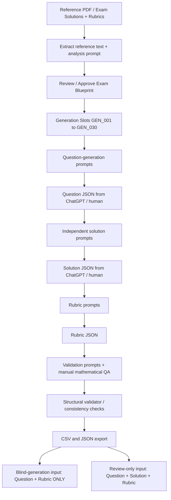

# CEDT Mathematics Exam Generation Pipeline

ระบบ Pipeline แบบ reproducible สำหรับข้อสอบ **GEN_001–GEN_030** ที่สร้างไว้แล้ว รวมถึงเป็นต้นแบบสำหรับสร้าง/แก้ไขชุดข้อสอบใหม่ตาม Blueprint เดิม

> **สำคัญ**: โหมดเริ่มต้นนำ Dataset ที่มีอยู่มา validate → export → prepare prompts โดยไม่เรียก AI API เอง จึงทำงานแบบออฟไลน์และไม่ใช้ API key. การสร้าง/ตรวจโจทย์ใหม่ใช้ prompt packets ที่นำไปใช้ใน ChatGPT ได้ แล้ว import กลับมาผ่าน `ingest`.

## Pipeline architecture



## Run (Windows / macOS / Linux)

ต้องมี **Python 3.10+** เท่านั้น; ใช้ Python Standard Library และ **ไม่ต้อง `pip install`** เพื่อ build dataset

จากโฟลเดอร์ `CEDT_Exam_Pipeline`:

```bash
python run_pipeline.py run
```

หรือบน Windows ดับเบิลคลิก `run_windows.bat` / บน macOS-Linux ใช้ `bash run_unix.sh`.

การทำงานนี้สร้างไฟล์ใน `output/`:

- `dataset/questions.csv`, `dataset/questions.json` — โจทย์ครบ 30 ข้อ
- `dataset/solutions.csv`, `dataset/solutions.json` — เฉลยทีละขั้น
- `dataset/rubrics.csv`, `dataset/rubrics.json` — Rubric 141 criteria
- `dataset/metadata.csv`, `dataset/metadata.json` — Concept, difficulty, reference, generation rationale
- `dataset/all_in_one.csv`, `dataset/all_in_one.json` — ข้อมูลทั้งหมดรวมกัน
- `blind_generation/` — เฉพาะ Question + Rubric **ไม่มีเฉลย**
- `review_only/review_inputs_WITH_SOLUTIONS.json` — ข้อมูลเฉลย ใช้เฉพาะตรวจสอบ
- `prompts/questions/`, `prompts/solutions/`, `prompts/rubrics/`, `prompts/review/` — 120 prompt packets แยก stage
- `validation_report.json` — ผลตรวจสอบโครงสร้างและผลรวมคะแนน
- `manifest.json` — SHA256 ของ input และรายการไฟล์ output

## Pipeline commands

| Command | Purpose |
|---|---|
| `python run_pipeline.py reference` | แปลง PDF เป็นข้อความและเตรียม Reference Analysis prompt (ต้องมี `pdftotext` จาก Poppler) |
| `python run_pipeline.py blueprint` | สร้าง 30 Generation Slots จาก Metadata ที่อนุมัติแล้ว |
| `python run_pipeline.py prompts --stage questions` | สร้าง prompt สำหรับโจทย์ใหม่ **โดยไม่รวมเฉลย** |
| `python run_pipeline.py prompts --stage solutions` | สร้าง prompt ให้แก้โจทย์จาก Question เท่านั้น ไม่ดู Gold Solution |
| `python run_pipeline.py prompts --stage rubrics` | สร้าง prompt สำหรับ Rubric จาก Question + Solution |
| `python run_pipeline.py prompts --stage review` | สร้าง prompt สำหรับตรวจสอบ โดยจงใจใช้ Solution และ Rubric |
| `python run_pipeline.py validate` | ตรวจความครบถ้วน, key, topic, difficulty, score |
| `python run_pipeline.py run` | validate + export + blind/review split + prompt packets |
| `python -m unittest discover -s tests -v` | รันการทดสอบ unit tests |

`config/blueprint.json` เป็น Blueprint ที่ยึดตามข้อสอบ 30 ข้อเดิม หากออกแบบ Blueprint ใหม่ ควรตรวจสอบและอนุมัติสัดส่วนก่อนเรียก `blueprint` ทับไฟล์เดิม

## สร้างหรือแก้ไขข้อสอบใหม่ตาม Blueprint

1. เปิดไฟล์ `output/prompts/questions/GEN_011_questions.md` (เปลี่ยน ID ตามที่ต้องการ) แล้วนำ prompt ไปใช้กับ ChatGPT เพื่อสร้าง **เฉพาะโจทย์** ในรูป JSON.
2. ตรวจโจทย์ที่สร้างใหม่ก่อน จากนั้นใช้ `output/prompts/solutions/GEN_011_solutions.md` เพื่อแก้โจทย์ **โดยไม่แสดง Gold Solution** (prompts ถูกสร้างจาก seed data เดิม; ถ้าโจทย์เปลี่ยน ให้ ingest คำถามและ regenerate prompts ก่อน)
3. ใช้ prompt จาก `output/prompts/rubrics/` สร้างเกณฑ์คะแนน แล้วใช้ `output/prompts/review/` ตรวจความถูกต้องเชิงคณิตศาสตร์
4. รวมผลลัพธ์แต่ละ stage ด้วย `ingest` โดยไม่แก้ dataset ต้นฉบับ เช่น:

```bash
python run_pipeline.py ingest --stage questions --file candidates/GEN_011_question.json --replace
python run_pipeline.py prompts --stage solutions --source input/working
python run_pipeline.py ingest --stage solutions --file candidates/GEN_011_solution.json --replace
python run_pipeline.py prompts --stage rubrics --source input/working
python run_pipeline.py ingest --stage rubrics --file candidates/GEN_011_rubric.json --replace --replace-question-rubrics
python run_pipeline.py run --source input/working
```

**หมายเหตุ:** `--replace-question-rubrics` ใช้ลบเกณฑ์เดิมของคำถามที่อยู่ในไฟล์ candidate ก่อนเพิ่มเกณฑ์ใหม่ เพื่อไม่ให้เกณฑ์ซ้ำ หากสร้างโจทย์ใหม่ที่คะแนนเต็มหรือ Concept ต่างไป ต้องแก้ Metadata/Blueprint ให้สอดคล้องกันด้วย และไม่ควรใช้ข้อมูล `solution` จาก seed เก่าเมื่อสร้าง rubric ใหม่. ตัว `ingest` รองรับ JSON object หรือ list และ `--replace` ต้องระบุเมื่อปรับรายการเดิม. ก่อนผลิต dataset ใหม่ให้ตรวจ Rubrics แบบอิสระ ไม่ใช้ผล `PASS` ของโมเดลเป็นหลักฐานว่าถูกต้องแล้ว

## Validation behavior

ระบบตรวจ:

- ครบและไม่ซ้ำ: `GEN_001`–`GEN_030`, คำถาม เฉลย Metadata
- Every rubric criterion ID unique, no orphan, order ถูกต้องต่อข้อ
- ผลรวมคะแนน rubric ต่อข้อตรง `rubric_max_score`
- Topic distribution ตรง Blueprint (4/4/3/4/4/4/4/3)
- Difficulty distribution ตรง Blueprint (19 Medium, 11 Hard)
- คะแนนรวม 190 คะแนน
- Consistency ข้าม Questions / Metadata / Blueprint
- Data preservation ผ่าน CSV/JSON export and read-back (unit test)
- ไม่เผย Gold Solution ใน `blind_generation`

**ไม่ได้ตรวจพิสูจน์คณิตศาสตร์ให้อัตโนมัติ**: รายงานจะระบุ `independent_mathematical_review: NOT_PERFORMED` เสมอ ค่า `validation_status: PASS` ที่อยู่ใน Metadata นั้นเป็นผลภายในจากชุดที่เขียนไว้ก่อนหน้า ไม่ใช่ผล review จากคนอิสระ

## Input and source limitations

- `input/reference/solutions_and_rubric_problems_1_8.pdf` เป็น **เฉลยและ rubric** ของ reference exam ไม่ใช่กระดาษโจทย์ต้นฉบับครบถ้วน
- `input/source/` มี 4 CSV ต้นฉบับที่ถอดจาก GEN_001–030, ห้ามแก้ถ้าอยากรักษา canonical seed
- PDF text extractor อาจอ่านสมการหรือภาพผิด โดยเฉพาะรูปกราฟ ต้องเทียบกับหน้า PDF เสมอ
- Prompt สำหรับ `questions` ใช้ข้อมูลจาก Blueprint slots ไม่ได้เปิด reference solutions เพื่อป้องกันการลอก/แปลงตัวเลขอย่างเดียว
- Generation is **human-in-the-loop** (ChatGPT chat or model of choice); ไม่มีการส่ง HTTP request หรือเรียก OpenAI API อัตโนมัติ

## Tests

```bash
python -m unittest discover -s tests -v
```

ครอบคลุม ID/score validation, duplicate detection, no solution leakage, prompt-stage isolation, และ CSV/JSON round-trip.
